# GeoModel Studio documentation

Use these guides from the first project settings through grid construction, properties, volumetrics and export. Each app page's collapsible **Guide** panel opens the corresponding step file. Labels in bold match the user interface.

## End-to-end process

```mermaid
flowchart LR
  P[Project setup] --> S[Surfaces]
  S --> Poly[Polygons / boundary]
  Poly --> F[Faults]
  F --> W[Wells and well tops]
  W --> SM[Structural model]
  SM --> G[Zones and 3D grid]
  G --> PR[Property modelling]
  PR --> V[Volumetrics]
  V --> QC[3D window and analysis]
  QC --> U[Upscaling, optional]
  U --> E[Export]
```

Surfaces, polygons, faults, wells and tops are optional according to the study; the process may branch or omit unavailable interpretation inputs. Readiness/status markers identify whether an object is current, stale or not yet available.

## Step guides and workflows

| Type | File | Covers |
|---|---|---|
| Step | [01 Project setup](01-project-setup.md) | Project, CRS/units, area and boundary |
| Step | [02 Surfaces](02-surfaces.md) | Surface import, creation, QC and filters |
| Step | [03 Polygons](03-polygons.md) | Polygon editing, import and boundary |
| Step | [04 Faults](04-faults.md) | Trace definition and fault parameters |
| Step | [05 Wells](05-wells.md) | Well paths and import/edit |
| Step | [06 Well tops](06-well-tops.md) | Pick import and QC |
| Step | [07 Structural model](07-structural-model.md) | Horizon and fault workflow |
| Step | [08 Zones and 3D grid](08-zones-and-3d-grid.md) | Layering, gridding and checks |
| Step | [09 Property modelling](09-property-modelling.md) | Facies, petrophysics, saturation and jobs |
| Step | [10 Volumetrics](10-volumetrics.md) | Contact setup and results |
| Step | [11 3D window and display](11-3d-window-and-display.md) | Scene, display and cell inspection |
| Step | [12 Analysis and sections](12-analysis-and-sections.md) | Statistical and spatial QC |
| Step | [13 Upscaling](13-upscaling.md) | Coarse grid and property upscaling |
| Step | [14 Export](14-export.md) | Simulator and project output |
| Workflow | [01 Quick start](workflows/01-quick-start.md) | Fast route to first volumes |
| Workflow | [02 Structural framework to grid](workflows/02-structural-framework-to-grid.md) | Structural modelling sequence |
| Workflow | [03 Facies, petrophysics and saturation](workflows/03-facies-petrophysics-saturation.md) | Property sequence to volumetrics |
| Workflow | [04 Rerunnable property workflow](workflows/04-rerunnable-property-workflow.md) | Saved executable property jobs |
| Reference | [Detailed feature reference](reference.md) | Preserved detailed feature and algorithm notes |

## Conventions

- **Units and coordinates:** set the project CRS, XY unit, depth unit and vertical datum in **Project › Project**. Depth is positive down. Imported data must use the source file's actual units and depth/elevation convention; files do not establish the project CRS. Surface and grid export formats may not carry CRS metadata.
- **Object states:** **● ok** means current/ready; **◐ stale** means a dependency changed and the object should be rebuilt or recomputed; **○ missing** means the required object/output is not available. Do not treat stale snapshots as current.
- **Display ranges:** custom min/max values change visualization only, not property values. Save display edits with **Save colours**.
- **Workflow outputs:** grid properties are snapshots. Rerun dependent workflows after changing geometry, source properties, contacts or parameters.
- **UI labels:** bold text in step guides indicates visible page, panel, field, tab or button labels. Menu naming follows `Domain › Page`.

## Disclaimer

GeoModel Studio was built by Merouane Hamdani and is for non-commercial use only under PolyForm Noncommercial 1.0.0. Commercial use is not permitted. It is provided as-is without warranty and is a concept-modelling tool, not a substitute for validated commercial software. See [LICENSE](../LICENSE).
